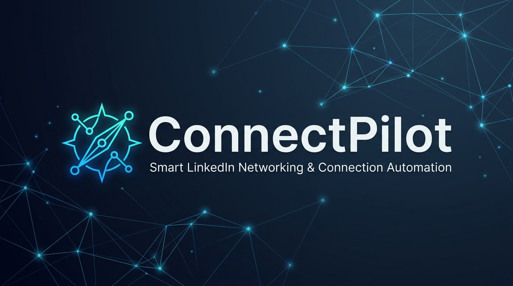

<div align="center">
  

  # ConnectPilot
  **Smart, Safety-First LinkedIn Networking & Connection Automation**

  [](LICENSE)
  [](https://www.python.org/downloads/)
  [](https://www.selenium.dev/)
  [](SETUP.md)
</div>

---

## Overview

**ConnectPilot** automates targeted LinkedIn connection outreach while prioritizing **account safety, zero-password persistent browser authentication, and multi-layered delivery verification**.

Unlike brittle scripts that blindly click "Connect" and inflate counts when LinkedIn silently rejects requests, ConnectPilot verifies every single invitation across **Chromium CDP network traffic (`2xx` vs `429 FUSE_LIMIT_EXCEEDED`)**, **Shadow DOM modals/toasts**, and **button state transitions (`Connect` -> `Pending`)**—automatically advancing your saved search page in `.env` so every daily run picks up right where the last run left off.

> **Setting this up for the first time (or using an AI agent)?**
> Jump straight to **[SETUP.md](SETUP.md)** — you can even tell your AI agent: *"Read `SETUP.md` and set up ConnectPilot on my machine."*

---

## Key Features

- **Passwordless Persistent Browser Profile (`Edge` & `Chrome`)** — Sign in once via Google SSO, Apple SSO, Passkey, or 2FA (`python cli.py browser-login`); your personal browser stays completely untouched. Also supports `LI_AT_COOKIE` and encrypted keyring credentials.
- **3-Layer Invitation Verification** — Confirms every invitation via CDP HTTP status codes, live DOM + Shadow DOM (`#interop-outlet`) toast inspection, and `Pending` state verification.
- **Instant Weekly Quota Protection** — Detects silent LinkedIn `HTTP 429 (FUSE_LIMIT_EXCEEDED)` responses and UI limit banners immediately, halting the run without skipping search pages.
- **Smart Search Pagination Memory** — Automatically persists your latest search results `page=N` URL back to `.env` after successful runs.
- **SQLite Rate Limiter & Audit Trail** — Enforces hourly, daily, and weekly safety caps and logs clickable profile URLs for every sent or failed attempt (`python cli.py stats`).
- **100% Portable `.env` Configuration** — Zero hardcoded machine paths; works across Windows, macOS, and Linux, and ships with an AI-agent-ready scheduled automation template ([`automation/sidecar.example.json`](automation/sidecar.example.json)).

---

## Quick Start

Full human + AI-agent setup instructions are in **[SETUP.md](SETUP.md)**.

```bash
# 1. Clone the repository
git clone https://github.com/Qasim-AJ/connect-pilot.git
cd connect-pilot

# 2. Create virtual environment & install dependencies
python -m venv .venv
# Windows: .\.venv\Scripts\activate  |  macOS/Linux: source .venv/bin/activate
pip install -r requirements.txt

# 3. Configure your .env file
cp .env.example .env   # (Windows PowerShell/CMD: copy .env.example .env)
# Paste your target LinkedIn People Search URL into SEARCH_LINK in .env

# 4. Sign into LinkedIn once in the dedicated browser profile
python cli.py browser-login

# 5. Send connection requests!
python main.py --limit 15

# 6. View statistics & recent profile links
python cli.py stats
```

---

## CLI Commands

```bash
# Open dedicated persistent browser profile for one-time LinkedIn login
python cli.py browser-login

# Run outreach via Rich CLI with live progress bar
python cli.py run --limit 15

# Display daily/weekly quota usage & latest 15 sent/failed profile URLs
python cli.py stats
python cli.py stats --today
python cli.py stats --format json

# Inspect or clean saved cookie sessions
python cli.py sessions
python cli.py clean --max-age 48

# Test rate limits or browser setup
python cli.py test --check-rate-limits
python cli.py test --check-browser
```

---

## Project Architecture

```text
connect-pilot/
├── main.py                      # Main orchestrator & unattended CLI runner
├── cli.py                       # Click + Rich interactive CLI (`run`, `stats`, `browser-login`, etc.)
├── SETUP.md                     # Step-by-step human & AI-agent setup guide
├── .env.example                 # Portable environment configuration template
├── automation/
│   └── sidecar.example.json     # Scheduled daily agent automation template
├── config/
│   ├── settings.py              # Typed settings & repo-relative path resolution
│   ├── security.py              # Fernet + PBKDF2 + OS Keyring credential manager
│   └── constants.py             # LinkedIn URLs, selectors & rate-limit constants
├── modules/
│   ├── authenticator.py         # Browser-profile, `li_at` cookie, session & 2FA login
│   ├── connector.py             # Search processing, Shadow-DOM modals & 3-layer verification
│   ├── rate_limiter.py          # SQLite quota enforcement & connection history
│   └── session_manager.py       # Encrypted cookie session persistence
├── utils/
│   ├── anti_detection.py        # Stealth Edge/Chrome/Firefox drivers & human behavior simulation
│   ├── cdp_daemon.py            # Persistent single-WebSocket CDP bridge for Edge 136+
│   ├── logger.py                # Rotating & colored structured logging
│   └── exceptions.py            # Domain exception hierarchy
└── tests/
    └── test_invitation_verification.py  # Unit tests for CDP/UI verification & rate limiter
```

---

## Responsible Use & Disclaimer

ConnectPilot is provided for educational and personal productivity research. Automated interaction with LinkedIn may conflict with LinkedIn's Terms of Service. Always use conservative limits (`10–20` invitations/day, `<100`/week), connect with relevant professionals, and use at your own discretion.

---

## License

Licensed under the [MIT License](LICENSE).  
Authored and maintained by **Syed Muhammad Qasim Ali**.
